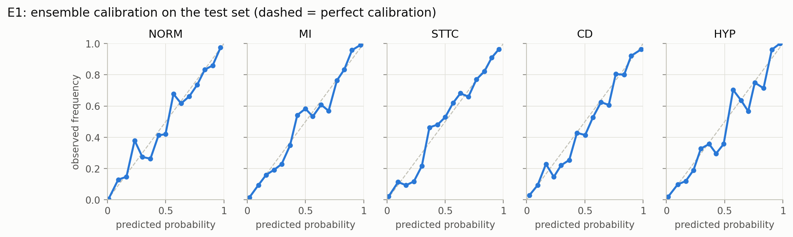
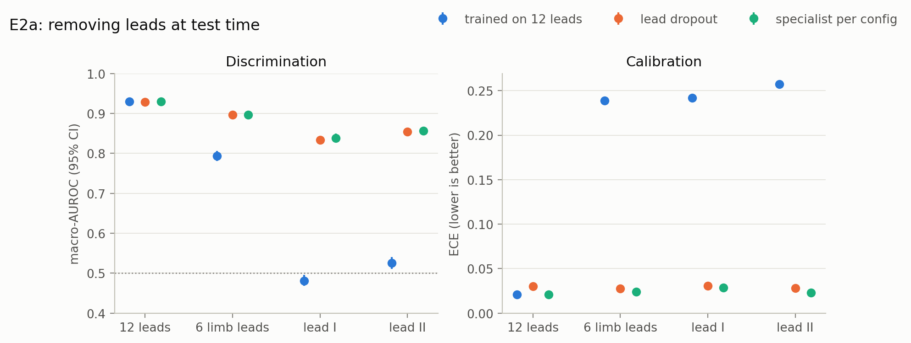
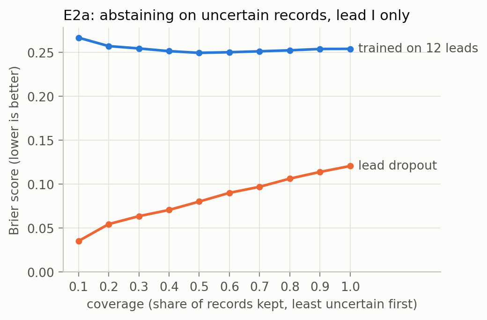
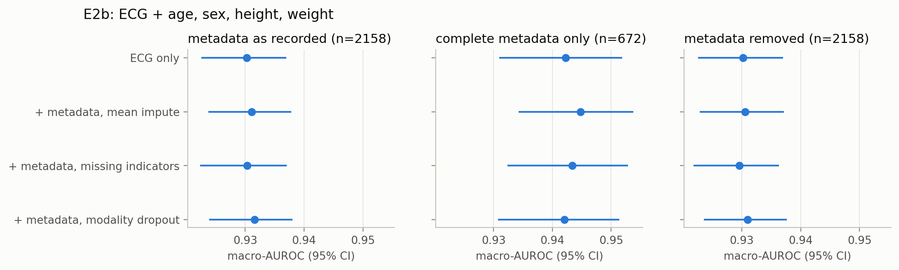
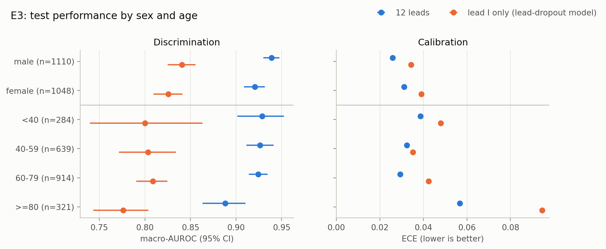

# Reliable ECG classification with missing inputs

How does a deep ECG classifier behave when part of its input is missing, and when is it less reliable for some patients than for others?

This repository studies those two questions on PTB-XL, a public dataset of 21,799 clinical 12-lead ECGs (Wagner et al., 2020). It covers:

- **Missing modalities:** ECG leads that are absent at test time (E2a), and patient metadata that is missing in a systematic, non-random way (E2b).
- **Uncertainty:** deep ensembles of five networks (Lakshminarayanan et al., 2017). From the ensemble come predictive entropy (total uncertainty), mutual information (the part due to the model) and risk–coverage curves.
- **Calibration:** reliability diagrams, ECE and the Brier score.
- **Subgroup reliability:** discrimination and calibration by sex and age, with patient-level bootstrap tests of the gaps between groups (E3).

Every number is computed on the official PTB-XL test fold. Confidence intervals are 95% intervals from a bootstrap that resamples patients, not individual ECGs, because one patient can have several recordings.

## Motivation

Models that work well on complete, curated benchmark data meet different conditions in practice:

- A wearable records one lead instead of twelve.
- A hospital site never records the patient's height.
- The patients the model serves differ from the ones it was tested on.

A model fit for practice should keep working when inputs are missing. It should also show its uncertainty when it cannot, and it should be equally reliable across patient groups. Each experiment tests one of these properties directly.

## Data and setup

| | |
|---|---|
| Dataset | PTB-XL v1.0.3, 100 Hz, 10 s, 12 leads |
| Task | Multi-label classification into the 5 diagnostic superclasses: NORM, MI, STTC, CD, HYP |
| Records | 21,388 with at least one superclass label, from 18,617 patients |
| Split | Official stratified folds: 1–8 train (17,084), 9 validation (2,146), 10 test (2,158) |
| Model | 1D ResNet, about 1.1M parameters, in the style of the PTB-XL benchmark networks |
| Lead and metadata inputs | The network receives a lead mask, so it knows which leads are present. Metadata enters through a small MLP whose output is concatenated with the pooled ECG features (late fusion). |
| Training | Binary cross-entropy, AdamW (lr 1e-3, weight decay 1e-2), cosine schedule, early stopping on validation macro-AUROC |
| Ensembles | 5 seeds per configuration |
| Metrics | Macro-AUROC, Brier score and ECE (15 bins per class, averaged). ECE is reported as a point value: binned ECE is biased upward, so its bootstrap intervals are not trustworthy. |

All model and strategy choices are made on the validation fold. The test fold is used only for the reported numbers.

## Results

### E1: baseline

The 12-lead ensemble reaches **macro-AUROC 0.930 [0.923, 0.937]** on the test fold, with Brier 0.079 [0.075, 0.084] and ECE 0.021. This is in line with published PTB-XL benchmarks for comparable 1D ResNets (Strodthoff et al., 2021). Per-class AUROC ranges from 0.908 (HYP) to 0.950 (NORM). The reliability diagrams stay close to the diagonal for all five classes.



### E2a: missing leads

Leads are removed at test time to simulate three reduced setups:

- the 6 limb leads, as recorded without chest electrodes;
- lead I, as recorded by a smartwatch;
- lead II, the usual monitoring lead.

Three strategies are compared:

1. **Trained on 12 leads:** the E1 model, used as is.
2. **Lead dropout:** a single model trained on random lead subsets. Half of the training examples keep all 12 leads.
3. **Specialist:** a separate model trained for each lead setup. This is the reference upper bound.

| Test macro-AUROC | 12 leads | 6 limb leads | lead II | lead I |
|---|---|---|---|---|
| Trained on 12 leads | 0.930 | 0.794 | 0.525 | 0.481 |
| Lead dropout | 0.929 | 0.896 | 0.854 | 0.834 |
| Specialist per setup | 0.930 | 0.897 | 0.857 | 0.838 |

- **The 12-lead model fails when leads are missing.** On a single lead it performs at chance level, and its ECE rises from 0.02 to about 0.25. Zeroed leads resemble pathology to this model: its mean predicted probability of NORM drops to 0.09, against a true prevalence of 0.45.
- **One lead-dropout model handles every setup.** It comes within 0.004 AUROC of the specialists, costs nothing on full 12-lead input, and keeps ECE at about 0.03 throughout.



**Uncertainty.** As leads are removed from the lead-dropout model, its predictive entropy rises (0.23 on 12 leads, 0.36 on lead I), while its mutual information falls (0.020 to 0.008). The added uncertainty therefore comes from ambiguity in the input, not from disagreement between ensemble members.

**Abstaining.** If the model keeps only the less uncertain half of the lead-I records, the Brier score improves from 0.121 to 0.080. The 12-lead model gains almost nothing from abstaining, because its entropy does not identify which records it gets wrong. A model's uncertainty is only useful if it was trained on the kind of input it receives.



### E2b: missing metadata

Age, sex, height and weight are added to the ECG through late fusion. Age and sex are always recorded. Height is missing for 68% of records and weight for 56%. The missingness is far from random:

- It depends on the recording site. At the largest site (8,671 records) height is missing 99.8% of the time; at the second largest (6,242 records), only 5.5% of the time.
- Site, device and recording year predict whether height is missing with a cross-validated AUROC of 0.88 (0.79 for weight).
- Records without height have a higher MI prevalence (28.2% vs 20.2%).

Three ways of handling missing values are compared:

- **Mean imputation:** missing values are replaced by the training mean.
- **Missing indicators:** imputed values plus one binary "is missing" flag per field.
- **Modality dropout:** the indicator inputs, with 30% of training records having all their metadata removed.

Each model is evaluated in three conditions: metadata as recorded, only records with complete metadata, and all metadata removed.



- **Adding metadata does not change discrimination.** With metadata as recorded, test macro-AUROC is 0.930 for ECG only and 0.930–0.932 for the three fusion models, all within each other's confidence intervals. The ECG itself already carries much of the information in age and sex.
- **No strategy breaks when metadata is removed.** AUROC stays at 0.930–0.931.
- **On the subset with complete metadata (n = 672), every model scores higher, including the ECG-only model** (0.942 vs 0.930). The difference comes from *which patients* have complete metadata (mostly one site), not from the metadata. Evaluating only on patients with complete data would overstate the effect of adding metadata.
- **Missing indicators slightly worsen calibration** (ECE 0.031 vs 0.021). This is consistent with the indicators encoding the recording site.

### E3: subgroups by sex and age

Per-group results for the 12-lead E1 ensemble and for the lead-dropout model on lead I only:



The gaps are tested directly with a bootstrap that resamples patients from both groups together. Overlapping per-group intervals alone do not show whether two groups differ.

| Gap in test macro-AUROC [95% CI] | 12 leads (E1) | Lead-dropout model, lead I |
|---|---|---|
| Male − female | +0.018 [0.004, 0.033] | +0.015 [−0.007, 0.037] |
| ≥80 years − 60–79 years | −0.036 [−0.064, −0.011] | −0.033 [−0.066, 0.002] |
| <40 years − 60–79 years | +0.004 [−0.021, 0.031] | −0.009 [−0.075, 0.055] |

- **Sex.** The 12-lead model discriminates slightly worse for women. The Brier score is also worse for women (−0.012 [−0.021, −0.003], male minus female). The two groups have similar label prevalences. The gap shows up in NORM, MI, STTC and CD but not in HYP. It persists in the fusion model, which receives sex as an input.
- **Age.** Patients aged 80 and over are the least well served: lower AUROC and the highest ECE (0.057, rising to 0.094 on lead I). Part of this reflects a harder label mix rather than the model alone. NORM prevalence falls from 83% under 40 to 7% at 80 and over, and older patients more often carry several diagnoses at once.
- **The model's uncertainty rises with its error.** Mean predictive entropy grows from 0.16 (<40) to 0.33 (≥80), so the ensemble signals lower confidence in the group where it performs worst.
- **Comparing groups needs care.** Subgroup AUROC is compared between single groups (here against the largest age group) rather than against "everyone else". AUROC computed over pooled groups also rewards separating those groups from each other, which inflates it.

## Limitations and next steps

- **One dataset, no external validation.** All results come from PTB-XL's own test fold. Validation on an independent cohort is the obvious next step.
- **Cross-sectional only.** Each ECG is classified on its own. Repeated recordings of the same patient are handled in the statistics but not modelled, and there is no modelling of disease progression.
- **No causal analysis.** The subgroup gaps and the missingness patterns are described, not explained causally.
- **Metadata is a weak modality here.** Four demographic fields add little to a 12-lead ECG. Modalities that carry more independent information, such as clinical history or lab values, would test fusion under missingness more strongly.
- **Age and sex play two roles.** They are inputs to the fusion model and also define the subgroups in E3. The primary subgroup analysis therefore uses the ECG-only model.
- **Simulated lead removal.** Removing leads from 12-lead recordings is not the same as recording with a single-lead device, whose signal quality and electrode placement differ.

## Reproduce

```bash
python -m venv .venv
.venv/bin/pip install --extra-index-url https://download.pytorch.org/whl/cu118 -r requirements.txt
.venv/bin/pip install -e .
DEVICE=cuda:0 bash scripts/run_all.sh
```

`run_all.sh` runs the whole pipeline in order:

1. downloads PTB-XL from PhysioNet;
2. runs the tests;
3. runs the missingness analysis;
4. trains and evaluates every ensemble (E1, E2a, E2b);
5. computes the subgroup analysis (E3);
6. draws the figures.

Ensembles that already have checkpoints are loaded instead of retrained. Results are written to `results/` and figures to `figures/`; up to GPU nondeterminism, they match the committed ones.

```
src/ptbxl_reliable/   data loading, lead masks, model, training, metrics, uncertainty, metadata features, subgroups
scripts/              one script per experiment, plus figures and run_all.sh
tests/                unit tests (pytest), runnable without the dataset
results/              all reported numbers as CSV
figures/              the figures above
```

## References

- Wagner, P. et al. (2020). PTB-XL, a large publicly available electrocardiography dataset. *Scientific Data* 7, 154.
- Strodthoff, N., Wagner, P., Schaeffter, T., Samek, W. (2021). Deep learning for ECG analysis: benchmarks and insights from PTB-XL. *IEEE Journal of Biomedical and Health Informatics* 25(5), 1519–1528.
- Lakshminarayanan, B., Pritzel, A., Blundell, C. (2017). Simple and scalable predictive uncertainty estimation using deep ensembles. *NeurIPS*.
