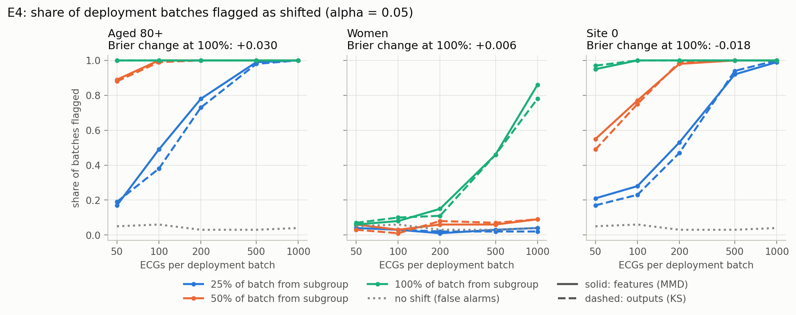
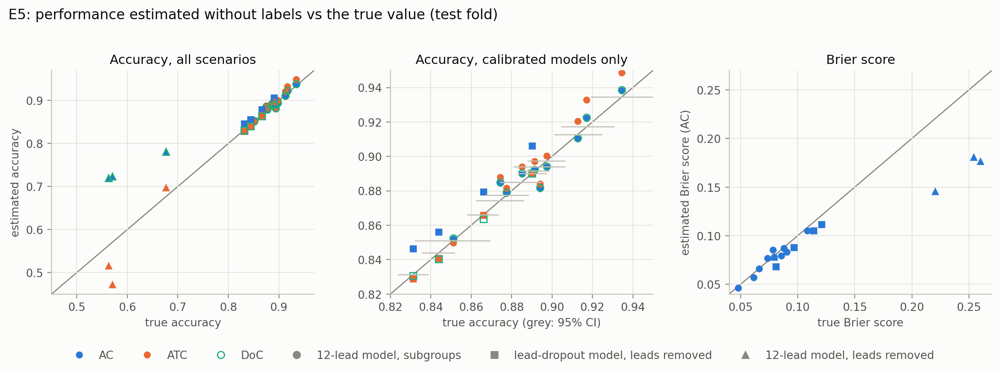
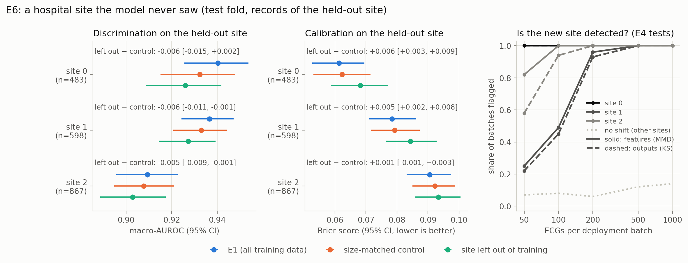
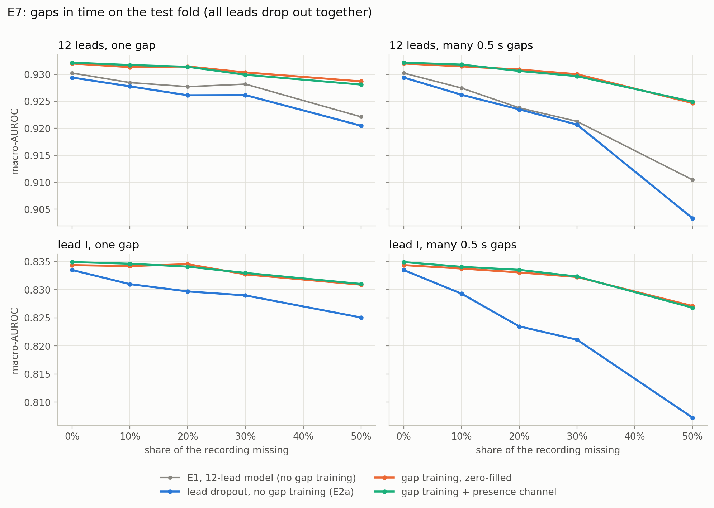
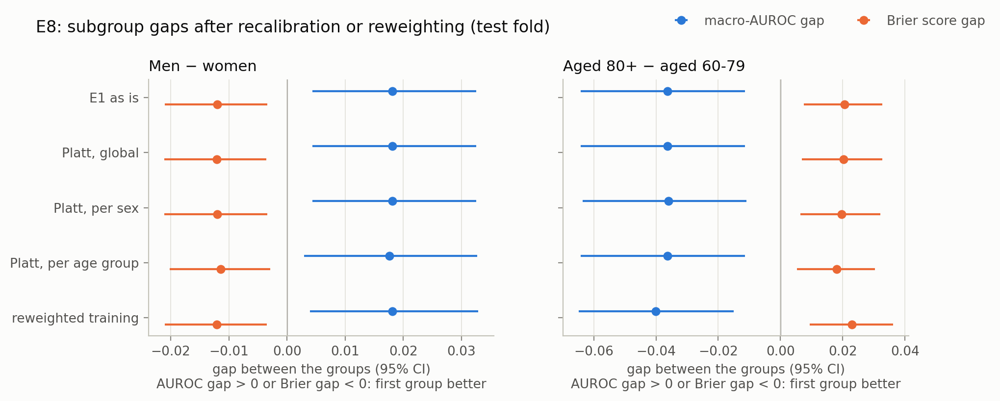

# Reliable ECG classification with missing inputs

How does a deep ECG classifier behave when part of its input is missing, and when is it less reliable for some patients than for others?

This repository studies those two questions on PTB-XL, a public dataset of 21,799 clinical 12-lead ECGs (Wagner et al., 2020). It covers:

- **Missing modalities:** ECG leads that are absent at test time (E2a), patient metadata that is missing in a systematic, non-random way (E2b), and stretches of signal lost in time, as with a wearable (E7).
- **Uncertainty:** deep ensembles of five networks (Lakshminarayanan et al., 2017). From the ensemble come predictive entropy (total uncertainty), mutual information (the part due to the model) and risk–coverage curves.
- **Calibration:** reliability diagrams, ECE and the Brier score.
- **Subgroup reliability:** discrimination and calibration by sex and age, with patient-level bootstrap tests of the gaps between groups (E3), and whether recalibration or reweighted training narrows those gaps (E8).
- **Monitoring after deployment:** whether a statistical test notices that the patient population has changed (E4), and whether the model's performance can be estimated without labels (E5).
- **A hospital the model never saw:** the cost of deploying at a recording site left out of training, separated from the cost of having less training data, and whether E4 and E5 notice (E6).

Every model performance number is computed on the official PTB-XL test fold. Confidence intervals are 95% intervals from a bootstrap that resamples patients, not individual ECGs, because one patient can have several recordings.

## Motivation

Models that work well on complete, curated benchmark data meet different conditions in practice:

- A wearable records one lead instead of twelve.
- A hospital site never records the patient's height.
- The patients the model serves differ from the ones it was tested on.

A model fit for practice should keep working when inputs are missing. It should also show its uncertainty when it cannot, and it should be equally reliable across patient groups. Each experiment tests one of these properties directly.

## Data and setup

| | |
|---|---|
| Dataset | PTB-XL v1.0.3, 100 Hz, 10 s, 12 leads |
| Task | Multi-label classification into the 5 diagnostic superclasses: NORM, MI, STTC, CD, HYP |
| Records | 21,388 with at least one superclass label, from 18,617 patients |
| Split | Official stratified folds: 1–8 train (17,084), 9 validation (2,146), 10 test (2,158) |
| Model | 1D ResNet, about 1.1M parameters, in the style of the PTB-XL benchmark networks |
| Lead and metadata inputs | The network receives a lead mask, so it knows which leads are present. Metadata enters through a small MLP whose output is concatenated with the pooled ECG features (late fusion). |
| Training | Binary cross-entropy, AdamW (lr 1e-3, weight decay 1e-2), cosine schedule, early stopping on validation macro-AUROC |
| Ensembles | 5 seeds per configuration |
| Metrics | Macro-AUROC, Brier score and ECE (15 bins per class, averaged). ECE is reported as a point value: binned ECE is biased upward, so its bootstrap intervals are not trustworthy. |

All model and strategy choices are made on the validation fold. The test fold is used only for the reported numbers.

## Results

### E1: baseline

The 12-lead ensemble reaches **macro-AUROC 0.930 [0.923, 0.937]** on the test fold, with Brier 0.079 [0.075, 0.084] and ECE 0.021. This matches the published PTB-XL benchmark for the same task, sampling rate and splits: 0.930 for resnet1d_wang and 0.928 for xresnet1d101 (Strodthoff et al., 2021, Table II). Per-class AUROC [95% CI]: NORM 0.950 [0.941, 0.958], STTC 0.940 [0.927, 0.950], MI 0.930 [0.918, 0.940], CD 0.924 [0.907, 0.938], HYP 0.908 [0.886, 0.926]. The reliability diagrams stay close to the diagonal for all five classes.


### E2a: missing leads

Leads are removed at test time to simulate three reduced setups:

- the 6 limb leads, as recorded without chest electrodes;
- lead I, as recorded by a smartwatch;
- lead II, the usual monitoring lead.

Three strategies are compared:

1. **Trained on 12 leads:** the E1 model, used as is.
2. **Lead dropout:** a single model trained on random lead subsets. Half of the training examples keep all 12 leads.
3. **Specialist:** a separate model trained for each lead setup. This is the reference upper bound.

| Test macro-AUROC | 12 leads | 6 limb leads | lead II | lead I |
|---|---|---|---|---|
| Trained on 12 leads | 0.930 | 0.794 | 0.525 | 0.481 |
| Lead dropout | 0.929 | 0.896 | 0.854 | 0.834 |
| Specialist per setup | 0.930 | 0.897 | 0.857 | 0.838 |

- **The 12-lead model fails when leads are missing.** On a single lead it performs at chance level, and its ECE rises from 0.02 to about 0.25. Zeroed leads resemble pathology to this model: its mean predicted probability of NORM drops to 0.08–0.10, against a true prevalence of 0.45.
- **One lead-dropout model handles every setup.** It comes within 0.004 AUROC of the specialists, costs nothing in discrimination on full 12-lead input (0.929 vs 0.930), and keeps ECE at about 0.03 throughout.


**Uncertainty.** As leads are removed from the lead-dropout model, its predictive entropy rises (0.23 on 12 leads, 0.36 on lead I), while its mutual information falls (0.020 to 0.008). The added uncertainty therefore comes from ambiguity in the input, not from disagreement between ensemble members.

**Abstaining.** On lead I, if the lead-dropout model answers only on the more certain half of the records, its Brier score on those records falls from 0.121 to 0.080. The 12-lead model, given lead I, gains almost nothing (0.254 to 0.249): its entropy does not single out the records it gets wrong. A model's uncertainty is only useful if it was trained on the kind of input it receives. The Brier score is the risk measure here; AUROC within the retained records is not, because the class mix of the retained records changes with coverage.


### E2b: missing metadata

Age, sex, height and weight are added to the ECG through late fusion. Age and sex are always recorded. Height is missing for 68% of records and weight for 56%. The missingness is far from random:

- It depends on the recording site. At the largest site (8,671 records) height is missing 99.8% of the time; at the second largest (6,242 records), only 5.5% of the time.
- Site, device and recording year predict whether height is missing with a cross-validated AUROC of 0.88 (0.79 for weight).
- Records without height have a higher MI prevalence (28.2% vs 20.2%).

Three ways of handling missing values are compared:

- **Mean imputation:** missing values are replaced by the training mean.
- **Missing indicators:** imputed values plus one binary "is missing" flag per field.
- **Modality dropout:** the indicator inputs, with 30% of training records having all their metadata removed.

Each model is evaluated in three conditions: metadata as recorded, only records with complete metadata, and all metadata removed.


- **Adding metadata does not change discrimination.** With metadata as recorded, test macro-AUROC is 0.930 for ECG only and 0.930–0.932 for the three fusion models, differences of at most 0.002. The ECG itself already carries much of the information in age and sex: sex can be predicted from the ECG alone with AUC 0.92 (Strodthoff et al., 2021).
- **No strategy breaks when metadata is removed.** AUROC stays at 0.930–0.931.
- **On the subset with complete metadata (n = 672), every model scores higher, including the ECG-only model** (0.942 vs 0.930). The difference comes from *which patients* have complete metadata (mostly one site), not from the metadata. Evaluating only on patients with complete data would overstate the effect of adding metadata.
- **Missing indicators give a higher ECE** (0.031 vs 0.021), with the Brier score almost unchanged (0.081 vs 0.079). One possible reason is that the indicators partly encode the recording site.

### E3: subgroups by sex and age

Per-group results for the 12-lead E1 ensemble and for the lead-dropout model on lead I only:


The gaps are tested directly with a bootstrap that resamples patients from both groups together. Overlapping per-group intervals alone do not show whether two groups differ.

| Gap in test macro-AUROC [95% CI] | 12 leads (E1) | Lead-dropout model, lead I |
|---|---|---|
| Male − female | +0.018 [0.004, 0.033] | +0.015 [−0.007, 0.037] |
| ≥80 years − 60–79 years | −0.036 [−0.064, −0.011] | −0.033 [−0.066, 0.002] |
| <40 years − 60–79 years | +0.004 [−0.021, 0.031] | −0.009 [−0.075, 0.055] |

- **Sex.** The 12-lead model discriminates slightly worse for women. The Brier score is also worse for women (−0.012 [−0.021, −0.003], male minus female). Label prevalences are similar between the groups except for STTC (21% in men, 28% in women). The gap shows up in NORM, MI, STTC and CD but not in HYP. It persists in the fusion model, which receives sex as an input.
- **Age.** Patients aged 80 and over are the least well served: lower AUROC and a worse Brier score (+0.021 [0.008, 0.033] vs 60–79). Their ECE is also the highest (0.057, rising to 0.094 on lead I), although ECE values from groups of different size are only descriptive. Part of this reflects a harder label mix rather than the model alone. NORM prevalence falls from 83% under 40 to 7% at 80 and over, and older patients more often carry several diagnoses at once.
- **The model's uncertainty rises with its error.** Mean predictive entropy grows from 0.16 (<40) to 0.33 (≥80), so the ensemble signals lower confidence in the group where it performs worst.
- **Comparing groups needs care.** Subgroup AUROC is compared between single groups (here against the largest age group) rather than against "everyone else". AUROC computed over pooled groups also rewards separating those groups from each other, which inflates it.

### E4: detecting a population shift

After deployment the mix of patients can change without anyone noticing. Can a test on the model's unlabeled inputs and outputs tell, and how many ECGs does it need?

The validation fold is the reference. Simulated deployment batches are drawn from the test fold, with a share of each batch (25%, 50% or 100%) taken from one subgroup: patients aged 80 and over (15% of the test fold), women (49%) or recordings from site 0 (22%). Batches with no subgroup share measure false alarms. Each setting is repeated 100 times. Two tests, both at α = 0.05:

- **Outputs:** a Kolmogorov–Smirnov test per class on the 12-lead ensemble's predicted probabilities, Bonferroni-corrected over the five classes (Rabanser et al., 2019).
- **Features:** a kernel two-sample test (MMD, Gretton et al., 2012) on the network's internal features (one ensemble member, reduced to 32 dimensions by PCA fitted on the reference), with 200 permutations.



- **False alarms stay at the nominal level:** 1–6% of unshifted batches are flagged, for both tests and every batch size.
- **Older patients and site 0 are caught quickly.** When half of each batch comes from patients aged 80+, 88–89% of batches of 50 ECGs are already flagged. A 25% share needs about 500 ECGs for 80% detection, for both subgroups.
- **A shift towards women is almost invisible.** Batches made only of women are flagged in 46% of cases at 500 ECGs and 78–86% at 1,000; with a 50% share, never more than 9%. The model's Brier score is nonetheless worse on these batches (+0.006), in line with the sex gap in E3. Sex can be read from a 12-lead ECG (AUC 0.92, Strodthoff et al., 2021), yet this shift barely registers in the diagnostic model's outputs or features.
- **An alarm is not the same as harm.** Batches from site 0 are flagged as reliably as batches of older patients, but the model does better on them (Brier −0.018), while on older patients it does worse (+0.030). A shift test says *that* something changed, not whether it matters; E5 estimates the second part.
- **Features and outputs perform almost the same.** The feature test is slightly more sensitive at small shares (for example 49% vs 38% of batches flagged, aged 80+, 25% share, 100 ECGs), never by a large margin.

### E5: estimating performance without labels

A shift test says that something changed, not whether the model got worse. With no labels after deployment, can the model's own predictions tell how well it is doing?

Three estimators, each fitted on the validation fold and then applied to unlabeled test data:

- **AC** (average confidence): if the model is calibrated, it is right as often as it is confident. The same idea gives an expected Brier score, the mean of p(1 − p).
- **ATC** (Garg et al., 2022): a confidence threshold per class, chosen on validation data so that the share of records above it equals the accuracy.
- **DoC** (Guillory et al., 2021): validation accuracy, shifted by the change in average confidence.

The target is the accuracy of the 0.5-threshold decision, averaged over the five classes, and the Brier score. Scenarios: the 12-lead ensemble on ten subgroups of the test fold (age, sex, the three large sites, everyone), and the two E2a strategies with leads removed. For the lead scenarios the estimators are fitted on 12-lead validation predictions, because labels for the shifted input would not exist.



| Mean absolute error (max) | AC | ATC | DoC | AC, Brier score |
|---|---|---|---|---|
| 12-lead model, 10 subgroups | 0.004 (0.013) | 0.008 (0.016) | 0.005 (0.012) | 0.004 (0.007) |
| Lead-dropout model, 4 lead setups | 0.014 (0.016) | 0.002 (0.003) | 0.002 (0.004) | 0.010 (0.013) |
| 12-lead model, 3 reduced lead setups | 0.138 (0.156) | 0.056 (0.098) | 0.138 (0.157) | 0.077 (0.084) |

- **For a calibrated model the estimates are as good as the labels allow.** AC and DoC fall inside the 95% CI of the true accuracy for all ten subgroups (ATC for eight), and the Brier estimate inside its CI for all ten.
- **This tells the harmful shift from the harmless one in E4.** Estimated accuracy is 0.852 for patients aged 80+ (true 0.851) and 0.922 for site 0 (true 0.917), so a monitor combining E4 and E5 would flag both shifts but report a drop only for the first.
- **The lead-dropout model stays estimable when leads are removed.** ATC and DoC are within 0.004 of the true accuracy for every lead setup. AC over-estimates by a near-constant 0.012–0.016, because this model is slightly over-confident already on 12 leads; ATC and DoC remove that offset through the validation labels.
- **For the 12-lead model on fewer leads, every estimate breaks.** On lead I its true accuracy is 0.563; AC and DoC estimate 0.72, ATC 0.52, and the estimated Brier score is 0.18 against a true 0.25. AC and DoC still register a fall from 0.89, but only half of it, and ATC errs in both directions (0.47 against a true 0.57 on lead II). As in E2a, the model's confidence is only informative on the kind of input it was trained for.

### E6: a hospital site the model never saw

What does it cost to deploy at a hospital that contributed no training data, and do the monitoring tools of E4 and E5 catch it?

PTB-XL records which site each ECG comes from. For each of the three large sites (8,671, 6,242 and 5,019 ECGs), two new ensembles are trained:

- **Site left out:** trained on folds 1–8 and selected on fold 9, both without that site. Its signals are standardised with statistics from its own training set.
- **Size-matched control:** trained on a random subset of folds 1–8 of the same size, all sites included, and selected on the full fold 9. Leaving a site out also removes training data (45% of it, for site 0), so the contrast that measures "never saw the site" is left-out minus control, not left-out minus E1.

All three models (E1, control, left-out) are evaluated on the test-fold ECGs of the held-out site (483, 598 and 867 records). Differences between two models on the same records get a paired patient bootstrap.



| Held-out site | Left out − control, macro-AUROC | Left out − control, Brier | Control − E1, macro-AUROC |
|---|---|---|---|
| Site 0 | −0.006 [−0.015, +0.002] | +0.006 [+0.003, +0.009] | −0.008 [−0.014, −0.002] |
| Site 1 | −0.006 [−0.011, −0.001] | +0.005 [+0.002, +0.008] | −0.004 [−0.008, +0.001] |
| Site 2 | −0.005 [−0.009, −0.001] | +0.001 [−0.001, +0.003] | −0.002 [−0.005, +0.002] |

- **Never seeing a site costs about 0.005 macro-AUROC.** The loss is consistent across the three sites and excludes zero for two of them; the Brier score is worse by 0.005–0.006 at sites 0 and 1. On the other sites the left-out model is as good as the control, so the cost is specific to the new site.
- **Less training data costs about as much again.** For site 0, whose removal takes away 45% of the training set, the control already loses 0.008 against E1; the left-out model's total loss of 0.014 is roughly half data, half site.
- **Differences between sites are larger than either cost.** Even E1, which trained on all three sites, reaches 0.909 on site 2 against 0.941 on the other sites. Which hospital a model is tested at matters more here than whether it trained there.
- **The new site is detected quickly.** With the left-out model's fold 9 as reference, the E4 tests flag every batch from site 0 already at 50 ECGs, site 2 at 100 ECGs (feature test; 94% for the output test) and site 1 at 200 ECGs (93–96%). Batches from the sites the model did see are flagged 1–8% of the time; this rises to 10–14% for the largest batches in the site-2 setting, where batches of 500–1,000 ECGs are drawn with replacement from only 1,291 records and repeat many of them.
- **Label-free estimates are less exact on an unseen site.** The mean absolute error of the E5 estimators rises to 0.009 (AC), 0.017 (ATC) and 0.014 (DoC), against 0.004–0.008 for subgroups of sites the model saw (diamonds in the E5 figure). At site 2 the left-out model is over-confident: AC over-estimates its accuracy by 0.016 and under-estimates its Brier score (0.082 against 0.093), so the small loss there would go unnoticed without labels.
- **Site 0 is also the site that almost never records height (E2b).** A model deployed there would meet both problems at once: a site it never saw (E6) and missing metadata (E2b).

### E7: gaps in time

A wearable that loses skin contact drops the signal for a while, on every lead at once. How much does that hurt, does training with gaps help, and does the model need to be told where the gaps are?

Gaps are simulated on the test fold as either one contiguous gap or many 0.5 s gaps at random positions, covering 10–50% of the 10 s recording, and filled with zeros (the per-lead training mean). Gap positions are fixed by a seed, so every model sees the same gaps. Two new ensembles are trained like E2a's lead-dropout model, with gaps added: half of the training records keep the full signal, the other half lose up to 60% in a random pattern.

- **Zero-filled:** a gap looks exactly like a flat line.
- **Presence channel:** one extra input channel marks where the signal is present.

Both are selected on validation data with and without gaps. They are compared with E2a's lead-dropout model and with E1, neither of which saw gaps in training.



| 30% of the recording missing | Gap training (zero-filled) − E2a lead dropout, macro-AUROC | Presence channel − zero-filled, macro-AUROC |
|---|---|---|
| 12 leads, one gap | +0.004 [+0.002, +0.006] | −0.0004 [−0.0021, +0.0012] |
| 12 leads, many gaps | +0.009 [+0.006, +0.012] | −0.0004 [−0.0019, +0.0012] |
| Lead I, one gap | +0.004 [+0.001, +0.007] | +0.0003 [−0.0017, +0.0021] |
| Lead I, many gaps | +0.011 [+0.007, +0.015] | +0.0001 [−0.0020, +0.0022] |

- **Many short gaps hurt more than one long one.** Losing half the recording in one piece costs E1 only 0.008 macro-AUROC (0.930 to 0.922): five seconds of ECG still hold several heartbeats. Losing the same half in 0.5 s pieces costs 0.020 (to 0.910), and calibration suffers more than ranking: ECE rises from 0.021 to 0.093 and the Brier score from 0.079 to 0.111.
- **Training with gaps removes most of that loss, at no cost without gaps.** With 50% missing in short gaps, the gap-trained model keeps 0.925 on 12 leads (E2a's model: 0.903) and 0.827 on lead I (0.807), with ECE 0.028 against 0.090. Without gaps it is as good as before (0.932 and 0.834).
- **Telling the model where the gaps are adds nothing.** The presence channel changes macro-AUROC by at most 0.0004 and the Brier score by at most 0.0006, all intervals containing zero. A likely reason: an exactly flat stretch on every present lead does not occur in a real recording, so the zero-filled model can already tell where the gaps are.

### E8: narrowing the subgroup gaps

E3 found the 12-lead model worse for women than for men and worse for patients aged 80+ than for those aged 60–79. Can either gap be narrowed, and at what cost overall?

Four variants of the E1 model are compared:

- **Platt scaling** (Platt, 1999): a logistic map per class, fitted on the validation fold and applied to E1's test predictions. There are three versions:
  - one map for everyone;
  - one per sex;
  - one per age group.

  Sex and age are always recorded in PTB-XL, so the group is known at deployment. The map is monotone, so within the group it was fitted on it changes calibration but not the ranking: it cannot change a within-group AUROC.
- **Reweighted training:** a new ensemble trained like E1, with each record's loss weighted by the inverse size of its sex × age cell in the training set (eight cells, weights 0.53–3.14, mean 1), so every cell carries the same total weight.

A gap counts as narrowed only if the 95% CI of its change against E1 excludes zero. That change is computed on the same patient resamples for both models, not by comparing two separate intervals.



| Change in the gap vs E1 | Men − women, AUROC | Men − women, Brier | 80+ − 60–79, AUROC | 80+ − 60–79, Brier | Overall macro-AUROC vs E1 |
|---|---|---|---|---|---|
| Platt, global | 0 (by construction) | −0.0001 [−0.0006, +0.0005] | 0 (by construction) | −0.0003 [−0.0012, +0.0006] | 0 (by construction) |
| Platt, per sex | 0 (by construction) | 0.0000 [−0.0006, +0.0007] | +0.0004 [−0.0013, +0.0023] | −0.0010 [−0.0022, +0.0002] | +0.0001 [−0.0004, +0.0005] |
| Platt, per age group | −0.0005 [−0.0027, +0.0017] | +0.0006 [−0.0004, +0.0016] | 0 (by construction) | −0.0025 [−0.0041, −0.0010] | −0.0007 [−0.0019, +0.0003] |
| Reweighted training | 0.0000 [−0.0044, +0.0047] | −0.0001 [−0.0027, +0.0025] | −0.0038 [−0.0129, +0.0051] | +0.0024 [−0.0019, +0.0066] | −0.0035 [−0.0057, −0.0011] |

E1's gaps are +0.018 [+0.004, +0.033] (men − women) and −0.036 [−0.064, −0.011] (80+ − 60–79) in macro-AUROC, and −0.012 and +0.021 in Brier score.

- **Neither method narrows the sex gap.** No change in either metric excludes zero, and all are at least 20 times smaller than the gap itself.
- **Per-age recalibration narrows the age gap in Brier score, slightly.** The Brier gap between 80+ and 60–79 falls from 0.021 to 0.018 (change −0.0025 [−0.0041, −0.0010]), and ECE for patients aged 80+ from 0.057 to 0.053. It is the only change in the table whose interval excludes zero. Global and per-sex recalibration change nothing, because E1 is already well calibrated overall (ECE 0.021).
- **Reweighted training narrows nothing and costs overall.** All its gap changes contain zero. It loses 0.0035 [0.0011, 0.0057] macro-AUROC overall, its Brier score is worse by 0.0025 [0.0011, 0.0038], and its ECE rises from 0.021 to 0.028 (0.075 for patients aged 80+). Up-weighting rare cells changes the share of each diagnosis the model sees in training, which shifts its probabilities.
- **The gaps are not explained by calibration or by group size in training alone.** Women make up 48% of the training set, so under-representation cannot explain the sex gap, and making every age group weigh the same did not close the age gap. What drives them is not established here; harder cases are one candidate (test ECGs of patients aged 80+ carry 1.59 superclass labels on average, against 1.34 at 60–79), which a causal analysis would need to test.

## Limitations and next steps

- **One dataset, no external validation.** All results come from PTB-XL's own test fold. Validation on an independent cohort is the obvious next step.
- **Cross-sectional only.** Each ECG is classified on its own. Repeated recordings of the same patient are handled in the statistics but not modelled, and there is no modelling of disease progression.
- **No causal analysis.** The subgroup gaps and the missingness patterns are described, not explained causally.
- **Metadata is a weak modality here.** Four demographic fields add little to a 12-lead ECG. Modalities that carry more independent information, such as clinical history or lab values, would test fusion under missingness more strongly.
- **Age and sex play two roles.** They are inputs to the fusion model and also define the subgroups in E3. The primary subgroup analysis therefore uses the ECG-only model.
- **No correction for multiple comparisons.** E3 reports 6 gaps for each of 4 models with unadjusted 95% intervals.
- **Simulated lead removal.** Removing leads from 12-lead recordings is not the same as recording with a single-lead device, whose signal quality and electrode placement differ.

## Reproduce

```bash
python -m venv .venv
.venv/bin/pip install --extra-index-url https://download.pytorch.org/whl/cu118 -r requirements.txt
.venv/bin/pip install -e .
DEVICE=cuda:0 bash scripts/run_all.sh
```

`run_all.sh` runs the whole pipeline in order:

1. downloads PTB-XL from PhysioNet;
2. runs the tests;
3. runs the missingness analysis;
4. trains and evaluates every ensemble (E1, E2a, E2b);
5. computes the subgroup analysis (E3);
6. draws the figures.

Ensembles that already have checkpoints are loaded instead of retrained. Results are written to `results/` and figures to `figures/`; up to GPU nondeterminism, they match the committed ones.

```
src/ptbxl_reliable/   data loading, lead masks, model, training, metrics, uncertainty, metadata features, subgroups
scripts/              one script per experiment, plus figures and run_all.sh
tests/                unit tests (pytest), runnable without the dataset
results/              all reported numbers as CSV
figures/              the figures above
```

## References

- Wagner, P. et al. (2020). PTB-XL, a large publicly available electrocardiography dataset. *Scientific Data* 7, 154.
- Strodthoff, N., Wagner, P., Schaeffter, T., Samek, W. (2021). Deep learning for ECG analysis: benchmarks and insights from PTB-XL. *IEEE Journal of Biomedical and Health Informatics* 25(5), 1519–1528.
- Rabanser, S., Günnemann, S., Lipton, Z. C. (2019). Failing loudly: an empirical study of methods for detecting dataset shift. *NeurIPS*.
- Gretton, A., Borgwardt, K. M., Rasch, M. J., Schölkopf, B., Smola, A. (2012). A kernel two-sample test. *Journal of Machine Learning Research* 13, 723–773.
- Garg, S., Balakrishnan, S., Lipton, Z. C., Neyshabur, B., Sedghi, H. (2022). Leveraging unlabeled data to predict out-of-distribution performance. *ICLR*.
- Guillory, D., Shankar, V., Ebrahimi, S., Darrell, T., Schmidt, L. (2021). Predicting with confidence on unseen distributions. *ICCV*.
- Platt, J. (1999). Probabilistic outputs for support vector machines and comparisons to regularized likelihood methods. In *Advances in Large Margin Classifiers*, MIT Press, 61–74.
- Lakshminarayanan, B., Pritzel, A., Blundell, C. (2017). Simple and scalable predictive uncertainty estimation using deep ensembles. *NeurIPS*.
